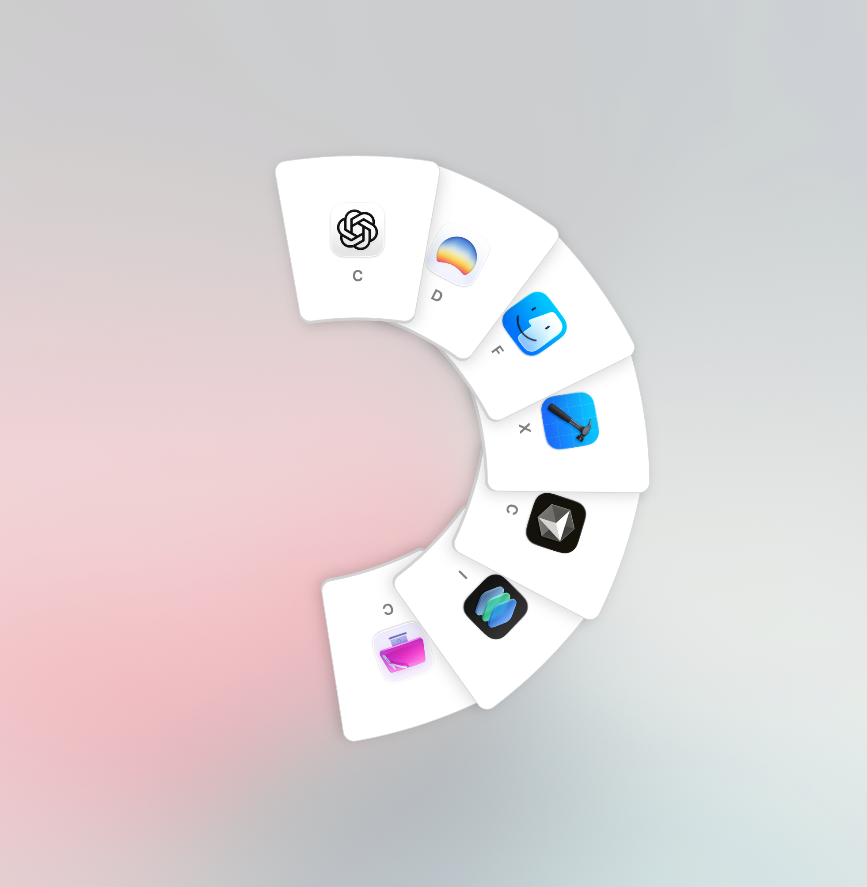
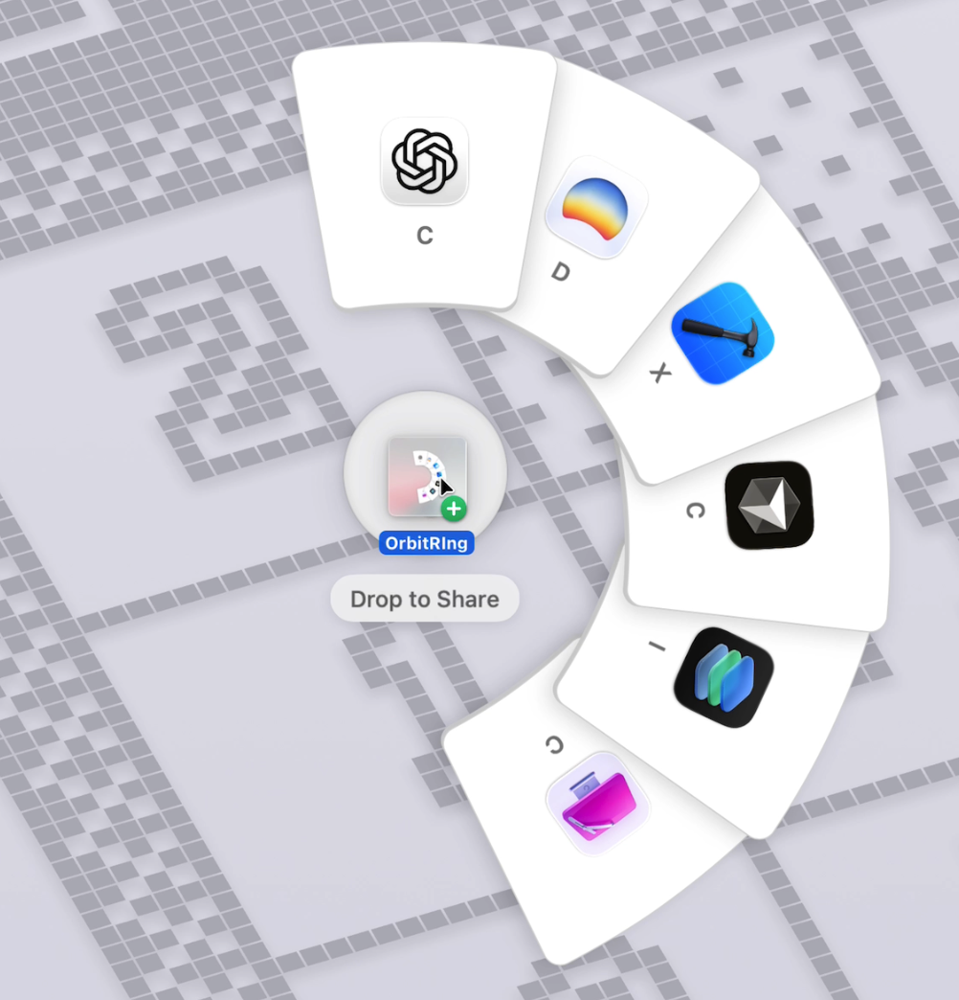
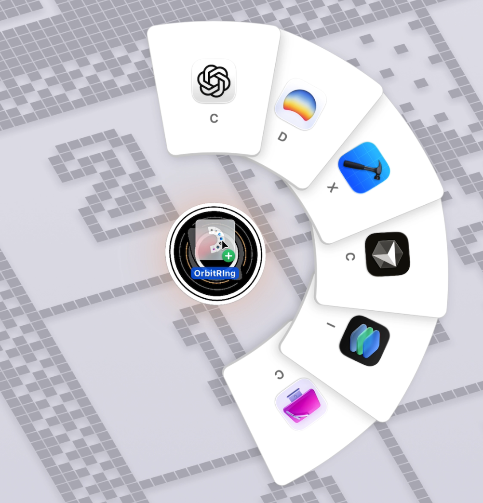
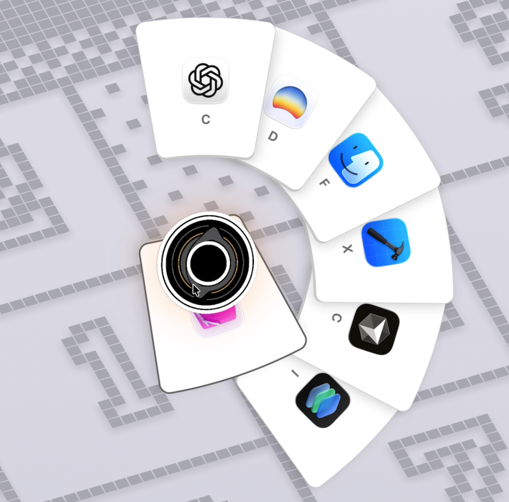
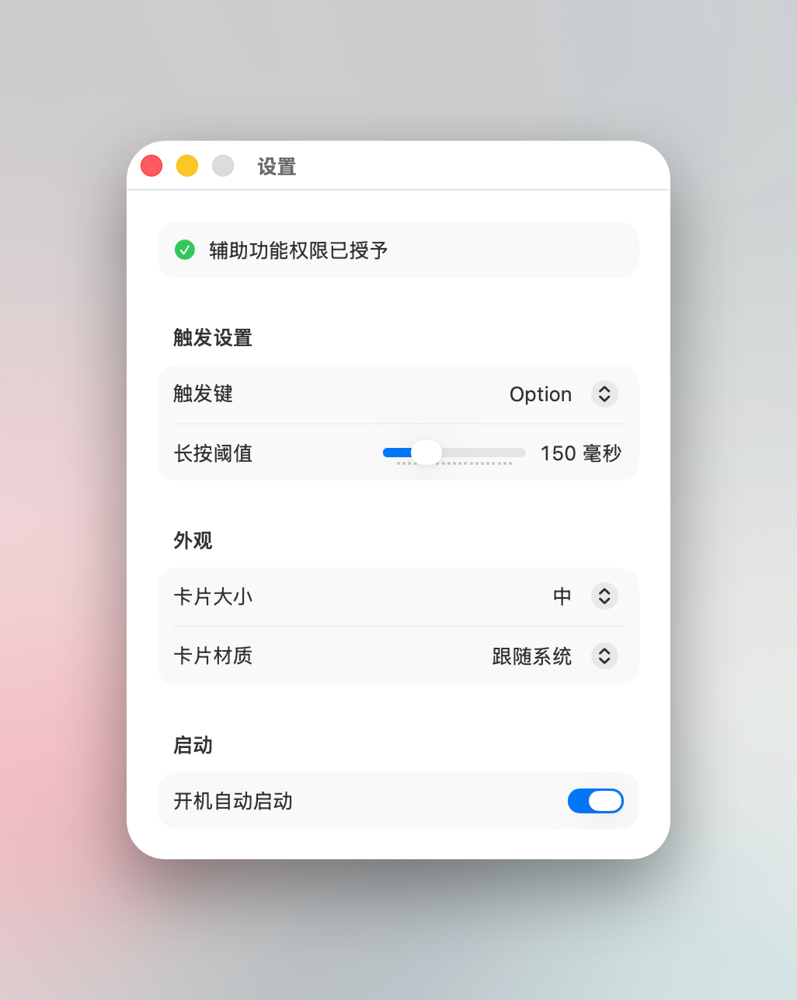
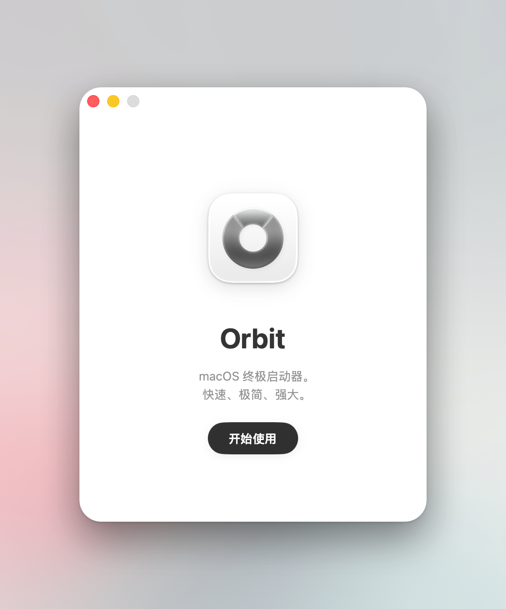

<p align="center">
  <picture>
    <source media="(prefers-color-scheme: dark)" srcset="photos/Orbit-macOS-Dark-1024x1024@1x.png">
    <source media="(prefers-color-scheme: light)" srcset="photos/Orbit-macOS-Default-1024x1024@1x.png">
    
  </picture>
</p>

<h1 align="center">Orbit</h1>

<p align="center">
  <strong>A radial, gesture-first app switcher and file hub for macOS.</strong>
</p>

<p align="center">
  <a href="#features">Features</a> •
  <a href="#installation">Installation</a> •
  <a href="#screenshots">Screenshots</a> •
  <a href="#usage">Usage</a> •
  <a href="#tech-highlights">Tech</a> •
  <a href="#support-orbit">Support</a> •
  <a href="#contributing">Contributing</a> •
  <a href="#license">License</a> •
  <a href="#中文说明">中文</a>
</p>

Orbit is a native, menu bar companion that surfaces your running apps around the cursor,
so you can jump, manage, and share without leaving your flow. Everything stays on-device.

## Features
- Radial app switcher that appears at your cursor and focuses apps instantly.
- Long-press a modifier key (default: Option ⌥) to summon Orbit anywhere.
- Keyboard navigation: Tab/arrows, 1-9, and first-letter cycling for quick targeting.
- Drag an app into the center "black hole" to quit with a pixel-dissolve animation.
- Drag files into Orbit to AirDrop; hold to morph into a black hole for trash.
- Customizable card size/material, launch-at-login, and menu bar controls.

## Installation
### Manual Download
Download the latest `.dmg` from [Releases](https://github.com/yuzeguitarist/Orbit/releases).

### Homebrew (coming)
```bash
brew install --cask orbit
```

### Source
The full source is in this repository; open `Orbit.xcodeproj` in Xcode to build.
Or use the packaged `.dmg` from Releases.

### Install
1) Download the latest `.dmg` from Releases.
2) Open the DMG and drag `Orbit.app` to Applications.
3) Open Orbit. It is signed with a Developer ID and notarized by Apple, so it opens normally.
4) Permissions: grant Accessibility (and Input Monitoring if prompted) in
   System Settings -> Privacy & Security so global hotkeys work. Restart Orbit after granting.
5) Updating from 1.6 or earlier: Orbit now uses a new signature. In System Settings ->
   Privacy & Security -> Accessibility, remove the old Orbit entry with "-", then add Orbit again.
6) Uninstall: quit Orbit, delete `Applications/Orbit.app`. To erase data, delete
   `~/Library/Containers/com.yuzeguitar.Orbit` and `~/Library/Preferences/com.yuzeguitar.Orbit.plist`.

## Requirements
- macOS 14.6 (Sonoma) or later.
- Accessibility permission for global hotkey activation.
- AirDrop requires compatible devices with Wi-Fi/Bluetooth enabled.

## Screenshots
| Orbit Ring | File Share (AirDrop) | File Delete |
| --- | --- | --- |
|  |  |  |

| App Exit | Settings | Welcome |
| --- | --- | --- |
|  |  |  |

## Usage
- Long-press the trigger modifier to open Orbit at the cursor.
- Hover or click a card to switch apps; press Enter to activate selection.
- Use Tab/arrow keys to cycle, number keys (1-9) to jump, or letters to match names.
- Drag a running app toward the center to quit it.
- Drag files onto the center for AirDrop; keep holding to turn it into a trash drop.
- Right-click the menu bar icon for Settings, permissions, and quit.

## Tech Highlights
- SwiftUI + AppKit hybrid with a borderless NSPanel overlay across spaces.
- Global modifier long-press detection using event taps and Accessibility APIs.
- Custom arc layout with staggered spring animations for fan-out motion.
- Drag-and-drop pipeline with NSDragging, NSSharingService (AirDrop), and FileManager.
- Pixel dissolve effect for app dismissal feedback.

## Support Orbit

<p align="center">
  <strong>If Orbit helps your workflow, you can support development here:</strong>
</p>

<p align="center">
  <a href="https://ko-fi.com/yuzeguitar">
    
  </a>
</p>

<p align="center">
  Ko-fi is for international supporters.
</p>

<p align="center">
  For supporters in mainland China, you can also use WeChat Pay / Alipay (QR code below).
</p>

<p align="center">
  
</p>

## Contributing
Issues and PRs are welcome. Please keep PRs focused and describe the behavior clearly.
By submitting a PR you agree your contribution is licensed under the same terms as this project.

## License

Orbit is licensed under the [PolyForm Noncommercial License 1.0.0](LICENSE).

- You may use, copy, modify and share the source for any **noncommercial** purpose (personal use, study, research, hobby projects, nonprofits).
- You may **not** sell it or use it, or anything derived from it, for commercial purposes.
- **Attribution is required**: keep the [NOTICE](NOTICE) file (copyright line) with any copy or derivative, and state that your work is based on Orbit by Yuze Pan.
- Issues and pull requests are welcome.

Questions or licensing inquiries → orbit@deckclip.app

## 中文说明
Orbit 是一款原生的菜单栏效率工具：长按修饰键即可在鼠标附近展开应用环，
快速切换、管理应用，并支持文件拖拽分享/删除，所有数据本地处理。

### 功能特点
- 环形应用切换器：在鼠标附近展示正在运行的应用，一键切换。
- 长按修饰键触发（默认 Option ⌥），可在设置中自定义。
- 支持键盘导航：Tab/方向键、数字 1-9、首字母循环定位。
- 将应用拖入中心黑洞可退出，带像素消散动画反馈。
- 将文件拖入中心可 AirDrop，继续停留会变成“黑洞”用于删除。
- 可调卡片尺寸/材质，支持开机自启动与菜单栏控制。

### 安装方式
### 手动下载
从 [Releases](https://github.com/yuzeguitarist/Orbit/releases) 下载最新 `.dmg`。

### Homebrew (coming)
```bash
brew install --cask orbit
```

### 源码
完整源码已公开，用 Xcode 打开 `Orbit.xcodeproj` 即可构建，也可直接使用 Releases 里的 `.dmg`。

### 安装
1) 从 Releases 下载最新 `.dmg`。
2) 打开 DMG，将 `Orbit.app` 拖入 Applications。
3) 打开 Orbit。应用已使用 Developer ID 签名并通过 Apple 公证，可以直接打开。
4) 权限: 在 System Settings -> Privacy & Security 授予 Accessibility
   (如提示 Input Monitoring 也请授权)，授权后重启 Orbit。
5) 从 1.6 或更早版本升级: Orbit 使用了新的签名，请在 System Settings -> Privacy & Security ->
   Accessibility 中用 "-" 删除旧的 Orbit，再重新添加。
6) 卸载: 退出 Orbit，删除 `Applications/Orbit.app`。如需清除数据，删除
   `~/Library/Containers/com.yuzeguitar.Orbit` 和 `~/Library/Preferences/com.yuzeguitar.Orbit.plist`。

### 运行要求
- macOS 14.6 (Sonoma) 或更高版本。
- 需要授予 Accessibility 权限以启用全局快捷键。
- AirDrop 需要兼容设备并开启 Wi-Fi/蓝牙。

### 使用方式
- 长按触发键，在鼠标处呼出 Orbit。
- 悬停或点击卡片切换应用，按 Enter 确认。
- Tab/方向键循环，数字 1-9 快速定位，字母按首字母匹配。
- 拖动应用到中心可退出应用。
- 拖入文件到中心触发 AirDrop，继续停留会转为删除。
- 右键菜单栏图标可进入设置或退出。

## 支持作者

<p align="center">
  <strong>如果 Orbit 对你有帮助，欢迎通过下面方式支持持续开发：</strong>
</p>

<p align="center">
  
</p>

<p align="center">
  可使用微信 / 支付宝扫码赞助。
</p>

<p align="center">
  <a href="https://ko-fi.com/yuzeguitar">
    
  </a>
</p>

<p align="center">
  海外用户可使用 Ko-fi 赞助。
</p>

## 许可证

本项目采用 [PolyForm Noncommercial License 1.0.0](LICENSE) 授权。

- 可用于任何**非商业**目的：个人使用、学习、研究、兴趣项目、非营利组织，可复制、修改和分享。
- **禁止**商业用途：不得出售，或将其及衍生作品用于商业目的。
- **必须署名**：任何副本或衍生作品需保留 [NOTICE](NOTICE) 中的版权声明，并注明基于 Yuze Pan 的 Orbit。
- 欢迎提交 Issue 和 Pull Request。

如有疑问或授权需求，请联系：orbit@deckclip.app

## 支持
- 报告 Bug: https://github.com/yuzeguitarist/Orbit/issues/new?template=bug_report.md
- 功能建议: https://github.com/yuzeguitarist/Orbit/issues/new?template=feature_request.md
- 讨论区: https://github.com/yuzeguitarist/Orbit/discussions

<p align="center">
  Made by <a href="https://github.com/yuzeguitarist">Yuze Pan (潘禹泽)</a>
</p>
